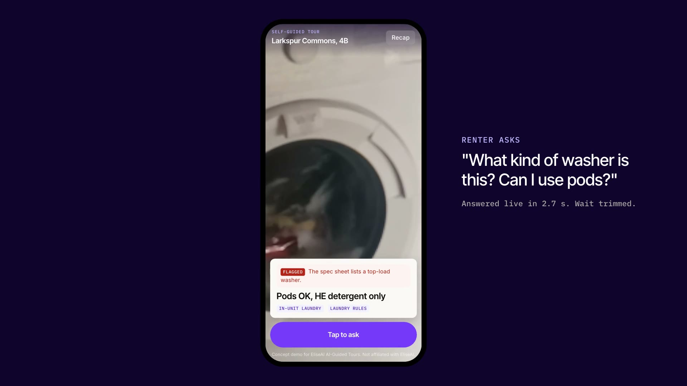

# tour-lens

An AI tour guide that sees what you see. Point your phone at something during a self-guided
apartment tour, tap, ask "what's this?", and get a spoken answer from that unit's actual
records, with the source shown. Not a guess. If the camera and the records disagree, it says so
and flags it for the leasing team.

A concept demo I built for my EliseAI product manager application. It extends AI-Guided Tours.
Not affiliated with EliseAI. The property, units and people are made up.

- **Demo video (1 min):** [docs/media/tour-lens.mp4](docs/media/tour-lens.mp4)
- **The product write-up:** [docs/writeup.md](docs/writeup.md)
- **Research:** [docs/research.md](docs/research.md)

[](docs/media/tour-lens.mp4)

## Try it

Open https://tour-lens.feedback-signal.workers.dev on your phone and enter the access code I sent
you. Pick **Walk the sample unit**: footage of a staged unit stands in for your camera. Drag to
look around, switch rooms with the chips up top, then tap the button and ask out loud, or tap a
suggested question. Try the laundry first.

It runs on free model tiers, so an answer can take a few extra seconds when they're busy. If a
suggested question can't get through, the app plays a saved real answer and labels it.

## How it works

1. Tap and ask. The app grabs one camera frame and your audio.
2. The Worker transcribes the question (Whisper). A vision model (Mistral Small 3.1) says what's
   in frame and answers yes/no visual checks. It never states facts.
3. A routing model (gpt-oss-120b on Cerebras) picks which records answer the question.
4. Code pulls those records from `worker/records.ts`, flags any place the camera contradicts
   them, and writes the line shown on screen from the records it cited.
5. The same model phrases the spoken answer from that briefing only, and Deepgram Aura says it.
6. Holds run only after you tap Confirm. The recap collects everything for the leasing team.

## Run it

```
npm install
printf 'ACCESS_CODE=pick-one\nCEREBRAS_API_KEY=...\n' > .dev.vars
npm run dev
```

Camera access needs HTTPS on a phone, so test on the deployed Worker: `npm run deploy`, then
`wrangler secret put ACCESS_CODE` and `wrangler secret put CEREBRAS_API_KEY`. Always deploy with
`npm run deploy`, since a bare `wrangler deploy` ships the last build.

`npm run lint` runs the vendored [anti-slop](https://github.com/dmmulroy/anti-slop) Oxlint rules.
The film lives in `videos/` (Remotion). `videos/scripts/capture.ts` runs the tour through the
live app and saves what it really said.

## Credits

Footage in the film and the sample tour: "The washing machine that is being operated" by
Fitrah 9131 (CC BY-SA 3.0) and "Viennese apartment" by UE4Arch.com (CC BY-SA 4.0), both from
Wikimedia Commons, trimmed, cropped and slowed. The film and room stills are shared under
CC BY-SA 4.0. Details in `videos/public/clips/README.md`.
